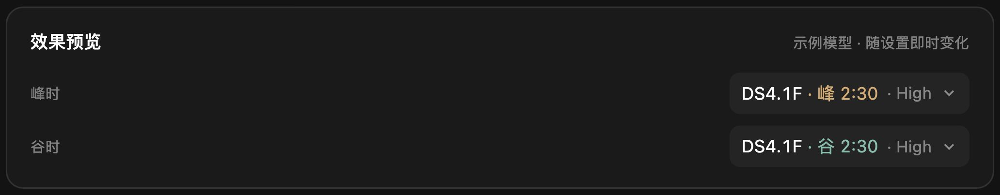
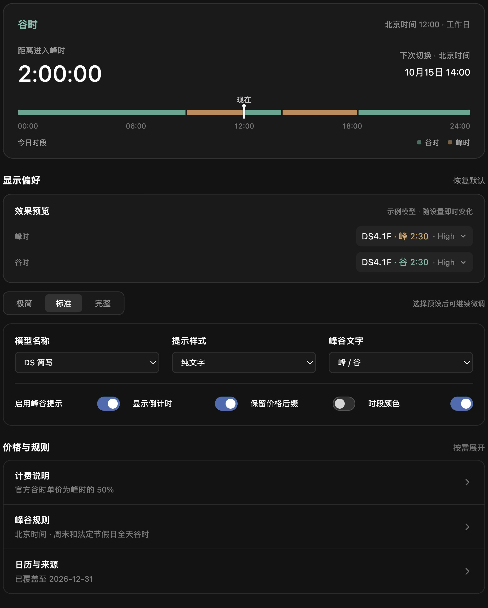

# 峰谷倒计时

独立插件 **dsh-peakclock**，当前版本 **0.1.1**，适配 **DeepSeek Harness 0.2.0-rc.2**。

在原生模型选择器中显示 `DS4.1F · 谷 2:30 · High`。峰时用琥珀色，谷时用青绿色；倒计时为小时:分钟，完整型号保留在悬停提示中。

## 截图

桌面 DSH 中的实际模型按钮：


峰时与谷时的显示效果：

<a href="docs/images/peak-valley-preview-hd.png"></a>

设置页包含当前状态、时间轴、显示偏好及可折叠的计费说明：

<a href="docs/images/settings-hd.png"></a>

后两张截图来自插件独立预览，使用示例模型和时间；展示的是实际插件组件，按三倍分辨率渲染，点击可查看高清原图。

## 安装

在 DSH 插件页选择“添加插件”，输入：

```text
github:oliblue-evan/dsh-peakclock
```

或使用 CLI（将 `desktop` 换成自己的 Profile 名称）：

```sh
dsh plugin --profile desktop add github:oliblue-evan/dsh-peakclock
```

仓库包含预构建产物，安装时无需编译源码。仅声明支持 DSH **0.2.0-rc.2**；其他版本须先核验兼容性。目前未发布 npm 包。

## 使用

打开“插件 → 峰谷倒计时”：

- 当前状态：峰/谷、秒级倒计时、下次切换时间和今日 24 小时时段轴。
- 显示偏好：常用选项与峰／谷双状态预览并排，短选项使用分段按钮，无系统下拉菜单；更多显示选项默认折叠。三套预设保留总开关、来源范围和提前时间。
- 倒计时：始终、临近切换或关闭；临近模式可提前 30／60 分钟显示，设置页仍保留完整的实时倒计时。
- 生效范围：所有可识别的 DeepSeek 模型，或仅 DSH 官方账号与官方 API 来源；第三方渠道不视为官方计费。
- 价格与规则：按需展开官方 API 的人民币价格快照、计费解释、峰谷规则与日历来源。

模型识别优先读取当前输入框所属会话的模型 ID；带渠道前缀和自定义显示名也可识别。ID 尚不可用时才以名称兜底。多个会话分别绑定各自输入框，不读取全局默认模型替代会话状态。

模型名称处通常按分钟刷新；设置页打开时共享时钟切换为秒级，关闭后恢复分钟级。页面隐藏时暂停前台时钟，唤醒时重新读取系统时间。

## 时段与计费参考

北京时间，周一至周五 09:00–12:00、14:00–18:00 为峰时，不含中国法定节假日；其余时间、周末和法定节假日全天为谷时，调休周末仍按谷时。

这里提供的是 [DeepSeek 官方时段与价格](https://api-docs.deepseek.com/zh-cn/quick_start/pricing/) 参考；第三方渠道可能有不同倍率、套餐和计费规则，以渠道账单为准。插件不读取 API 密钥、不查询余额、不修改模型或实际扣费。

价格为 2026-10-15 核对的静态快照，附官方最新价格链接，不假称实时同步。节假日日历沿用上游的验证逻辑，临近年末或缺少年份时从固定 holiday-cn 数据源尝试补充；无法确定下一次切换时明确显示“待核实”。

## 从旧版迁移

该独立包不会占用或修改原版 dsh-timeband 的包名、Loader ID 或样式所有权。

首次运行优先读取自己的存储；若尚无数据，会先尝试迁移独立试用版，再尝试迁移原本 `dsh-timeband` 的显示偏好、节假日日历和日历检查记录。旧数据保留；已有设置不会被旧数据覆盖。旧提醒、音效、弹出时间轴和更新检查不再包含在本包中。

安装新包前停用旧包，避免两套显示同时运行。建议保留旧包和 Profile 配置备份以便回滚。无需更改 DSH 宿主源码。

## 开发与检查

Node.js 22+，npm：

```sh
npm ci --ignore-scripts
npm run compatibility
npm run typecheck
npm run build
npm test
npm run test:browser
npm pack --ignore-scripts
npm run test:artifact -- ./dsh-peakclock-0.1.1.tgz
```

`compatibility` 仅核验精确目标 0.2.0-rc.2，不追随 npm latest，也不修改宿主。

`npm run preview` 提供仅浏览器使用的回归夹具：加载实际构建产物，以模拟会话验证别名、切换、开关、时间边界和卸载。它不是 DSH Web 实例，不读取真实 Profile、账号或对话。浏览器测试使用这一夹具；真实 SlotRegistry 生命周期和多会话隔离另有构建产物/DOM 测试。

客户端以 ModuleLoader 格式构建，运行时仅由宿主提供 React。模型身份来自公开的会话级 ModelDirectory；原生 ModelSelect 没有导出替换组件，因此显示层仍使用针对 rc.2 控件结构的窄范围 DOM 适配。它保留 React 原节点与原生事件，仅增加自有显示节点，禁用或卸载时恢复。宿主升级后需要重新核验控件结构；无法匹配的控件保留原生显示。

## 来源与许可

派生自 [dsh-timeband v1.3.4](https://github.com/a961282799-crypto/dsh-timeband)，保留其节假日与时段基础逻辑，并重做显示、设置、会话绑定和验证流程。这是独立维护的衍生插件。

MIT，原版权和许可全文保留在 LICENSE；来源记录见 NOTICE。
